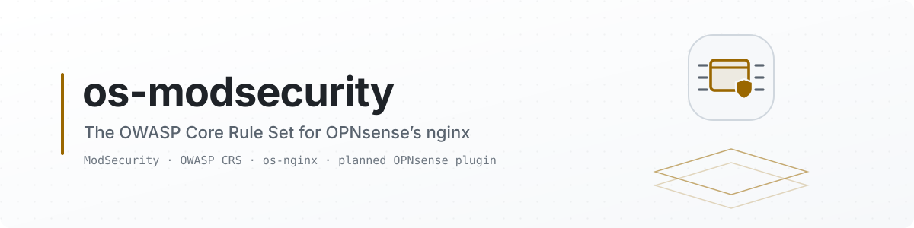

<picture>
  <source media="(prefers-color-scheme: dark)" srcset="docs/images/readme/banner-dark.svg">
  <source media="(prefers-color-scheme: light)" srcset="docs/images/readme/banner-light.svg">
  
</picture>

<p align="center">
  
  <a href="https://github.com/AbdelmonemAwad/os-modsecurity/actions/workflows/checks.yml"></a>
  <a href="LICENSE"></a>
  <a href="#what-is-tested"></a>
  <a href="https://github.com/AbdelmonemAwad/opnsense-arabic"></a>
  <a href="https://github.com/AbdelmonemAwad/os-xgs-npu"></a>
</p>

# ModSecurity for OPNsense

A Web Application Firewall in front of the sites published through the firewall: each request received
on the firewall by an Apache of the plugin's own, inspected by ModSecurity with the OWASP Core Rule Set,
and passed to the site's backend.

> ~~**Planned - nothing here runs yet.** This repository was opened on 2026-11-16 to hold
> ModSecurity as a plugin of its own. No code has been written or moved into it, and there is no
> release.~~
>
> **Written, not released (2026-11-20).** The first part is here: the sites, each one's mode and
> paranoia level, its certificate, and the Core Rule Set's install. Off by default. ~~It has not run on an
> appliance yet.~~ It ran on the second XGS 3300, the XGS 136 and a plain OPNsense on 2026-11-20, in plain
> HTTP: what was run is under [What is tested](#what-is-tested).

<p align="center"><b>Contents:</b> <a href="#what-it-does">What it does</a> &middot; <a href="#engine-and-why-it-is-not-the-plans">Engine, and why it is not the plan's</a> &middot; <a href="#where-the-rules-come-from">Where the rules come from</a> &middot; <a href="#what-it-does-not-do">What it does not do</a> &middot; <a href="#not-yet-and-why">Not yet, and why</a> &middot; <a href="#what-is-tested">What is tested</a> &middot; <a href="#installation">Installation</a> &middot; <a href="#updates">Updates</a> &middot; <a href="#where-it-fits">Where it fits</a> &middot; <a href="#licence">Licence</a></p>

## What it does

**Services: Web Application Firewall** (XGS: Web Application Firewall, order 67, when os-xgs-npu is
installed), one page, off by default:

- **sites** - each with its host names (a wildcard as the whole first label, `*.example.com`), its backend
  (`http://` or `https://`, an address or a name, a port, a path), its certificate of System: Trust or
  none, its mode and its paranoia level. A host name belongs to one site: the page refuses a name another
  site has, or one under another site's wildcard, since Apache would give such a request to one of them by
  the order of its configuration, which the page does not show - at a site's Save, and when the grid's
  switch turns a site on (OPNsense's own switch saves without the model's checks, so the plugin checks
  first and says why in OPNsense's dialog). A request for a name no site has meets a
  catch-all that refuses it with 403, not inspected.
- **modes** - *Detection only*, every new site's first mode: each request is inspected and what the rules
  find is written to the audit log, and the request passes. *Blocking*: a request the Core Rule Set judges
  an attack, by its anomaly score, is refused with 403. ModSecurity's own `SecRuleEngine`, set in each
  site's virtual hosts. In Blocking two more things are refused: a request body larger than 12.5 MiB with
  files, or 128 KiB without - a photo or file upload, a large JSON or form - with 413, before the Core Rule
  Set reads it (ModSecurity's recommended limits; what Detection only does with such a body is not measured
  yet); and, at every paranoia level, a method other than GET, HEAD, POST and OPTIONS (rule 911100) or a
  request content type the Core Rule Set does not list (920420), so a WebDAV or REST backend - PUT, DELETE,
  PROPFIND - stays in Detection only until a site can have exclusions. The site dialog says both.
- **paranoia levels** - 1 to 4, the Core Rule Set's own: level 1 for a new site, the fewest false
  positives; each level up runs more rules. Set for each site by a rule before the Core Rule Set's start
  (ids 19001 and on), by the host name its request names, which Apache chose the site by.
- **TLS** - a site with a certificate is served over HTTPS with it, and its plain HTTP requests are sent
  there; TLS 1.2 and 1.3 as Mozilla's intermediate profile has them. Without one, plain HTTP. A backend
  over HTTPS has its certificate checked, unless the site says not to: signed by an authority of the
  firewall's trust store, and valid for the site's host names - not for the name or address written in
  Backend. The host name the browser asked for is passed on (`ProxyPreserveHost`, for backends that serve
  several sites) and asked of the backend too (SNI), so the backend must present a certificate for the
  site's public name. A backend whose certificate names only itself needs the check turned off for its
  site; a switch per site to pass the backend's own name instead is for the plan's next part. A
  certificate renewed in System: Trust - os-acme-client renews them in place, and OPNsense tells no plugin -
  is served from the next Apply, or within a day without one: each day at 04:17 the certificates Apache
  serves are compared with System: Trust's, and one renewed is written again and Apache reloaded gracefully
  with it, nothing else of its configuration changed, so a setting saved and not applied still waits for
  Apply. To take it at once, an ACME automation or System: Settings: Cron can run the configd action "Apply
  the Web Application Firewall's settings".
- **where Apache listens** - Settings' Listen interfaces' addresses, as OPNsense's web GUI takes its own
  (followed when one gets a new address), or every address; an HTTP port (80) and an HTTPS port (443). A
  port the web GUI holds where Apache would listen is refused, never taken, and the page says how to move
  the GUI: another TCP port, or its Listen interfaces, in System: Settings: Administration. The plugin
  never changes the GUI's settings.
- **the audit log** - JSON, one record a line, a file a day in `/var/log/modsecurity/audit_YYYYMMDD.log`:
  each transaction that matched a rule, or was refused or failed, with its rule ids - without the
  request's body or uploaded files, its `Authorization`, `Proxy-Authorization`, `Cookie` and `Set-Cookie`
  headers masked where the record holds the request's and the response's headers (its parts B and F); a
  rule that matches one of their values writes the text it matched into its own message (part H), which
  nothing masks - whether ModSecurity 2.9.15 does there is not measured yet. Apache's
  own messages beside it (`error_YYYYMMDD.log`). Both kept as long as OPNsense keeps its own logs (System:
  Settings: Logging, 31 days by default), and under a total size - the smaller of 512 MiB and a quarter of
  the file system they are on, the oldest days going first, never today's: a day's own growth is not
  bounded. The page's table of what the rules found is the plan's next part.
- **Apply** - writes Apache's configuration from the page's settings with the plugin's templates
  (`templates/OPNsense/ModSecurity`), has Apache test it (`httpd -t`), and only then starts or reloads Apache
  with it: a configuration Apache refuses is put back as it was, and Apache goes on with what it had.
  `httpd -t` does not bind a port or load a certificate, so the files before - the configuration and the
  certificates it names - are kept until Apache runs the new ones: a graceful restart Apache does not survive
  (a port another program holds) puts them back and starts Apache with them again, and the page says the one
  before runs again; a start that fails puts them back and leaves Apache stopped, as it was. A reload is
  waited for until Apache's own log says it is done, 30 seconds at most. A site that cannot be served - a
  certificate without its key, no port for its kind - is left out, named on the page with its reason.
- **System: Services** lists it while it is on; it starts at boot while it is on.

A backend receives each request with the host name the browser asked for, `X-Forwarded-Proto` (`http` or
`https`) and, from Apache's mod_proxy, `X-Forwarded-For`, `X-Forwarded-Host` and `X-Forwarded-Server`. The
client's address is the last entry of `X-Forwarded-For`: Apache appends it to any the client sent itself,
so a backend that trusts the first entry can be told any address.

Nothing here adds a firewall rule: a site reached from another network needs a rule on that interface
passing its port to This Firewall, which the page reminds of. A site published by a port forward instead
never meets the rules.

**On an XGS appliance** a fifth card says what phase 0 measured: a site behind the firewall runs on the host
processor, never in hardware - a reverse proxy ends every connection on the firewall, which neither of
os-xgs-npu's flow makers offloads (a way out by `lo0`); on the second XGS 3300 (its coprocessor on vendor
version 22), 2,000 requests one at a time through Apache and the Core Rule Set at paranoia level 1 (plain
HTTP, Detection only): 148 a second, no flow in hardware, and about 75 a second for each host core, derived
from the processor time a request took - not a load test. On the XGS 136: not measured yet.

## Engine, and why it is not the plan's

The plan names libmodsecurity 3 with nginx's module, loaded into os-nginx's nginx. Phase 0 found that
cannot be built as written on OPNsense 26.7.9 (read on the second XGS 3300, 2026-11-19): OPNsense's
repository has neither libmodsecurity 3 nor its nginx connector, its nginx is built with `MODSECURITY3=off`
(and NAXSI on), os-nginx's `nginx.conf` writes a fixed list of `load_module` lines with no place for
another, and a separate nginx would be the same package with the same module missing. What OPNsense's
repository does build is **Apache 2.4.70 with ModSecurity 2.9.15** - `apache24` and `ap24-mod_security`,
the pairing the Core Rule Set documents for Apache - so this plugin depends on those two packages
(`PLUGIN_DEPENDS`), as os-frontpanel depends on lcdproc - `install/install.sh` installs them from
OPNsense's repository when they are not there, since 1.0.1 - and runs Apache as its own instance: its
configuration in `/usr/local/etc/os-modsecurity`, its pid file `/var/run/modsecurity.pid`, never the
package's own configuration. Not taken: building libmodsecurity 3 and the connector here for each nginx
update OPNsense publishes (binaries to build, sign and keep up), and Coraza, which OPNsense has no package
for.

## Where the rules come from

The OWASP Core Rule Set publishes its releases on GitHub, each signed with its project's PGP key
(fingerprint `3600 6F0E 0BA1 6783 2158 8211 38EE ACA1 AB8A 6E72`). A firewall has no gpg (OPNsense installs
none), so the signature is checked before a release reaches one: the owner's signing repository fetches
the release, checks it with gpg against that fingerprint, and republishes its minimal archive as a release
of this repository, `crs-<version>`, with `crs.json` (the archive's SHA-256 and size, the fingerprint it was
checked against) signed with the project's release key - the one chain of trust every plugin of the project
is installed by. **Install**, in Settings, takes the newest such release of the **4.25 line**, which receives
the Core Rule Set's security fixes as backports with fewer changes to its rules than the newest line, so
fewer new false positives: only when `crs.json`'s Ed25519 signature verifies with a key in `release-keys/`
and the archive is the one signed. The archive is unpacked into `/usr/local/etc/os-modsecurity/crs/<version>`
(its one top directory, files and directories only), its `crs-setup.conf.example` copied to `crs-setup.conf`
as the Core Rule Set's install says, tested by Apache, and only then used; the version before is kept until
the next install, and is made current again where Apply then finds Apache refusing the whole configuration
with the new one. Apache's configuration names the version's own directory, so a configuration put back
keeps the rules it ran with. A list of releases that cannot be read - a proxy's page in place of GitHub's -
is said as such, never as a line with no release.

By hand, an archive of the 4.25 line checked elsewhere with the Core Rule Set's own `gpg --verify` is taken
with the SHA-256 given, from a shell only - another line is refused, since Install would take the 4.25 line
back: `/usr/local/opnsense/scripts/modsecurity/crs.py install-archive <archive> <sha256>`.
The page then says it was installed by hand.

## What it does not do

- **change the web GUI** - its port, its interfaces, its redirect: a port it holds is refused;
- **add a firewall rule**, or a port forward;
- **inspect what a site sends back** - responses pass unread (`SecResponseBodyAccess Off`, as phase 0
  measured), so the Core Rule Set's rules on responses do not run;
- **HTTP/2 or WebSocket** - Apache speaks HTTP/1.1, to clients and to backends;
- **limit a flood of connections** - each request is read within bounds (`mod_reqtimeout`: the headers in 20
  to 40 seconds, the body at 500 bytes a second), so a slow client frees its worker; how many connections
  one address may open is pf's to limit, by a rule's maximum connections from one source;
- **touch the coprocessor** - nothing of os-xgs-npu is asked or changed.

## Not yet, and why

- **the table of what the rules found, exclusions, the Core Rule Set's updates** - the plan's next part:
  the incidents read from the JSON audit log with their rule ids (settled point 7a; phase 0 measured
  ModSecurity 2.9.15 accepting `SecAuditLogFormat JSON` and its records carrying the ids), exclusions for a
  site - its methods, its content types and a request body limit of its own among them, beside the one
  limit every site has now - and following the Core Rule Set's releases - the 4.25 line or the newest 4.x -
  by itself.
- **the Core Rule Set's releases** - none is published yet: the owner's signing repository has no job for
  them yet. Until then Install says the line has no release, and the lab installs one by hand.
- **the lab** - ~~none of this has run on an appliance yet.~~ run on 2026-11-20 on the second XGS 3300, the
  XGS 136 and a plain OPNsense in plain HTTP ([What is tested](#what-is-tested)); TLS - a site's certificate, an
  HTTPS backend's - waits for a test certificate. The plan's test: a site behind the firewall,
  known attacks - SQL injection, a script tag, a path with `../` - refused in Blocking and logged in
  Detection only, ordinary requests passing, each finding in the log with its rule id; on the second XGS
  3300, the XGS 136 and a plain OPNsense. Not measured yet: Apache with the plugin's configuration, TLS
  (phase 0's figures are plain HTTP), a paranoia level above 1, the cost of each level, the request body's
  limit in either mode, false positives on real sites; a graceful restart Apache does not survive and the
  configuration before started again, and how long a start and a reload take against the 30 seconds Apply
  waits for each; `mod_reqtimeout` in OPNsense's apache24 package and a slow client given 408; an HTTPS
  backend's certificate checked against the site's name; the grid's refusal shown in OPNsense's dialog; a
  renewed certificate taken by the daily check; what an audit record's rule messages (part H) hold of a
  masked header.
- **the page in a browser** - not opened yet, in either theme or language.

## What is tested

On 2026-11-20, from this branch, away from an appliance - the checks, run under Python 3.14, PHP 8.5 and
node 24:

- **the Apply** - `tools/test-setup.py`, 238 checks: host names, wildcards and backends read as the model
  reads them - one table with `tools/test-model.php` (`tools/fixtures/cases.json`) - and the web GUI's
  listeners and where they meet the plugin's ports; a config.xml as OPNsense 26.7 writes it
  (`tools/fixtures/config.xml`, every address a documentation one), its certificates and keys made by
  OpenSSL at each run; the sites given to Apache and those left out with their reasons, a name taken twice
  or under a wildcard; the certificates written with their chain, the keys 0600, nothing else kept once
  Apache took the configuration; Apache's configuration rendered from the templates - its listeners, the
  catch-alls, each site's mode, its paranoia rule matched as Apache matches its names, the redirect to
  HTTPS, an HTTPS backend checked or not, a wildcard-only site's ServerName, the JSON audit log, and nothing
  of an unchecked config.xml in it, `mod_reqtimeout`'s bounds, `retry=5`, the MPM's notices in the log, the
  Core Rule Set by its version's directory; the dialog's help said as the configuration does it - the
  backend's name check, the request body's limits; Apply's every way - off, each refusal (the packages, a
  module, `mod_reqtimeout` among them, the Core Rule Set, one port for both kinds, the web GUI's ports, no
  address, no site), Apache's test failing and the files put back, the start, the reload waited for until
  Apache's log says it is done, Apache gone after a reload - the files and certificates before put back and
  started again, or stopped where they do not start - and a start that fails, the files put back and
  nothing else started - and one at a time; a renewed certificate taken by the daily check and put back
  where Apache does not survive it; the logs' days and their total size; listen.php's addresses through a
  stand-in of `interfaces_addresses()`; the page's status in each state, the web GUI's interfaces by their
  descriptions;
- **the Core Rule Set** - `tools/test-crs.py`, 70 checks: releases made here and signed with throwaway keys -
  the newest of the line, a manifest refused for each field it must have, a key the firewall does not hold
  or none, each refusal by its code; a list of releases that holds no branch said as not read; the archive
  refused when it is not the one signed, holds a link, a device, a path outside its top directory, another
  version or too few rules - nothing in use changed; Apache refusing a release; the one before kept, and
  every version a configuration on disk names, an older one taken away; an archive by hand, of the 4.25
  line only; Apply after an install, and the version before made current again when Apply refuses the new
  one; one at a time;
- **the model** - `tools/test-model.php`, 133 checks: Settings and each site checked as a Save checks them,
  each refusal on its field and only where its part changed, a port written 080 and 80 one port, the web
  GUI's interfaces by their descriptions; the model's XML in step with `common.py`;
- **the page's API and the hook** - `tools/test-mvc.php`, 42 checks: the status - an answer that is no
  object, an empty list among them, taken as none - Apply and Install POST only, the grid's rows, the grid's
  switch through the real model and a copy of OPNsense 26.7's `toggleBase()` - a site turned on refused with
  the model's words where a Save would refuse it, one turned off always saved - the service while on, the
  start at boot, a new address followed only on a Listen interface chosen, every configd action asked for
  there, Apply and the install described for Cron;
- **the page's script** - `tools/test-page.js`, 49 checks, under node with a stand-in jQuery: the cards in
  each state, the fifth on an XGS appliance, the ports Apache listens on, the lines under them, each refusal
  of Apply and of Install in the page's words, markup or an entity in a value written as text and made
  plain once, Apply from Settings and from Sites, Install, the grid's columns;
- **the installation** - `tools/test-install.py`, 41 checks, in a temporary root: nothing copied without
  Apache and ModSecurity or with a syntax error, every file laid down with its mode and taken away, the menu
  at XGS 67 or under Services, the directories and who reads them, the rc script - start, reload as a
  graceful restart, stop, status, a pid file believed only when its process is this Apache - Apache stopped
  first at a removal, nothing of the plugin left, OPNsense's packages kept, nothing done by the old package
  in an upgrade;
- **the self-update** - `tools/test-self-update.py`, 45 checks, as os-blocklists has it;
- **the strings** - `tools/check-strings.py`: each of the 137 strings the GUI shows is in `source.json`; 24
  have their Arabic in opnsense-arabic already, the other 113 wait for it there;
- **the rest** - every installed file removed by the uninstaller (`tools/check-uninstall.sh`), `php -l`,
  `py_compile` and pyflakes, `sh -n`, XML and JSON, nothing private, no Arabic in the code, the copyright
  line; and, by hand, the page kit (kit).

Fifteen faults planted one at a time - the GUI's redirect port forgotten in either reading, a wildcard
that takes nothing, a refused configuration not put back, certificates taken away before Apache's test,
paranoia rules that do not stop at the first match, a release taken unsigned, an archive taken whatever its
SHA-256, a link in an archive, the pinned key not asked, a site checked though unchanged, a line written as
HTML, Apply by GET, the rc script believing any pid, the removal leaving the Core Rule Set - each was caught.
So was each of the 31 changes of the first part's fix round, undone one at a time: the files before not put
back after a reload or a start Apache did not survive, the reload taken as done at once, `mod_reqtimeout`
left out, the grid's switch saved unchecked, a renewed certificate not taken, Install's and Apply's codes
dropped, a refused Apply keeping the new rules, and the rest.

Measured in phase 0, on the second XGS 3300 (its coprocessor on vendor version 22; its lab, 2026-11-20,
Apache and the Core Rule Set v4.25.2 as that lab configured them, not this plugin): in Detection only an
SQL injection, a script tag and a path with `../` passed and were logged with rule ids of 942, 941 and
930; in Blocking the three were refused with 403 and a plain request answered 200; the audit log in JSON
with the ids; the rates above; and `pkg delete` of the two packages leaving nothing behind (`pkg
autoremove` then takes apr, gdbm and yajl, which they brought).

On the appliances and a plain OPNsense, the same day, after one review and one round of its fixes, from this
branch at 39122e2, as a user meets it - the second XGS 3300 (os-xgs-npu installed), the XGS 136 and a plain
OPNsense in qemu without os-xgs-npu - in plain HTTP (a test certificate for the TLS points waits), each box put
back as found after it:

- **the packages and the rules** - apache24 and ap24-mod_security from OPNsense's own repository (5 packages,
  mod_reqtimeout there); the Core Rule Set v4.25.2 installed by hand, its signature good by the pinned key and
  its sha256 phase 0's, 27 rule files; Settings' Install says, in its own words, that no release of the 4.25
  line is published for the plugin yet, and changes nothing;
- **the web GUI** - a port the GUI holds refused, with the message on how to move the GUI, config.xml unchanged;
- **one site, Detection only** - Apply 0.7 to 0.8 s, Apache running on F1's addresses alone; an SQL injection,
  a script tag and a `../` path answered and logged with 942100, 941100 and 930100; every audit record JSON,
  Authorization and Cookie masked;
- **Blocking** - the three refused with 403 and a plain request 200; a host no site names 403 by the catch-all;
  a 200 KiB form and a 13 MiB file 413; in Detection only both 200;
- **two sites** - each its own record (920230 in shop's, not www's); a host name of another site refused at the
  save; a configuration Apache refuses: Apply refused ("config") and Apache left running the one before;
- **the listeners** - a change of F1's address applied again and another interface's not; every address; no
  Listen interface, no Apply; a slow client given 408 within
  40 s (21.1 s);
- **a boot** - Apache running after it, the plain request 200; a reload 0.7 s, a start 0.8 s, `httpd -t` 0.12 s,
  2 processes, 109,428 KiB resident;
- **its cost** - 2000 requests one at a time on the second XGS 3300: 135 a second in Detection only (p50 7.03
  ms), 133 in Blocking (p50 7.11 ms); no flow of the sites' ports in the coprocessor's hardware;
- **the rest** - the audit log pruned by its age; the backend down: 503, then 200 within a second of it coming
  back; off: no Apache and gone from System: Services; the removal and a package built, added and deleted
  leaving nothing, the two Apache packages kept until deleted by name.

The lab's first runs found faults of the lab's own scripts alone (configd's name for an action with a dot, a
check reading a line the next call had written over, a field off by one, the GUI's redirect left on port 80
when the GUI moved, a console command too long); fixed there and run again. The plugin showed none.

Not tested: TLS - a site's certificate, an HTTPS backend's checked against its name, a renewed certificate taken
by the daily check (a test certificate waits); a paranoia level above 1 and its cost; false positives on real
sites; the page in a browser.

~~Not tested: anything on an appliance (above) - Apache itself has not read this configuration yet.~~

## Installation

It is not in the OPNsense plugin repository, so there is no `pkg install os-modsecurity`.

**From XGS: Updates' Plugins tab**, with os-xgs-npu 0.2.0-alpha.1 or later: Install takes the latest
release, checked against its signature, and runs its `install/install.sh`.

**From a checkout** of this repository, on the firewall, as root:

```sh
sh install/install.sh
```

It installs OPNsense's packages `apache24` and `ap24-mod_security` when they are not there, and stops,
with nothing of the plugin copied, when the firewall cannot install them from OPNsense's repository. It
checks the PHP with `php -l` and the Python with `py_compile`
before anything is copied, copies `src/` onto `/usr/local`, puts the page in the menu (`place-menu.sh`: XGS
with os-xgs-npu, Services without), and stops Apache, or applies again where the plugin is on: no site is
published until it is turned on in Settings and the Core Rule Set is installed. Safe to run again: the
settings in config.xml and the Core Rule Set installed are kept.

`sh install/uninstall.sh` stops Apache and removes the plugin's files, its menu entry and everything it
wrote: Apache's configuration and the certificates exported for it, the Core Rule Set, its logs and what it
last did. The settings stay in config.xml. `apache24` and `ap24-mod_security` go too when
`install/install.sh` installed them and no other package needs them, and stay otherwise; the packages they
brought with them stay (`pkg autoremove` takes away those nothing needs).

**From a package**: `tools/make-package.sh` builds it on a firewall, and
`release.yml` in a FreeBSD virtual machine for each release, as os-blocklists does; pkg then installs the
two packages with it.

## Updates

As os-blocklists: taken by hand, to this repository's **releases** - from **XGS: Updates**, its *Plugins*
tab, where an os-xgs-npu that lists this plugin is installed, or by running
`/usr/local/opnsense/scripts/modsecurity/self-update.py` (`check` to ask). A release is installed only as its
owner signed it (`release.json` and its Ed25519 signature, the public key in `release-keys/`), only forward,
by the `install/install.sh` it carries. No cron entry runs it. The Core Rule Set's releases, `crs-<version>`,
are never this repository's latest: the self-update does not see them.

## Where it fits

It is one part of the [os-xgs-npu](https://github.com/AbdelmonemAwad/os-xgs-npu) project, which puts OPNsense on Sophos XGS hardware, and works the way its other plugins do: changes by pull request, a release installed from **XGS: Updates**, its Arabic in [opnsense-arabic](https://github.com/AbdelmonemAwad/opnsense-arabic)'s catalogue. It installs the same on a plain OPNsense. os-nginx and its NAXSI are left as they are.

## Licence

BSD 2-Clause - see [LICENSE](LICENSE). The Core Rule Set it installs is the OWASP Core Rule Set project's,
under the Apache License 2.0, which travels inside its archive.
